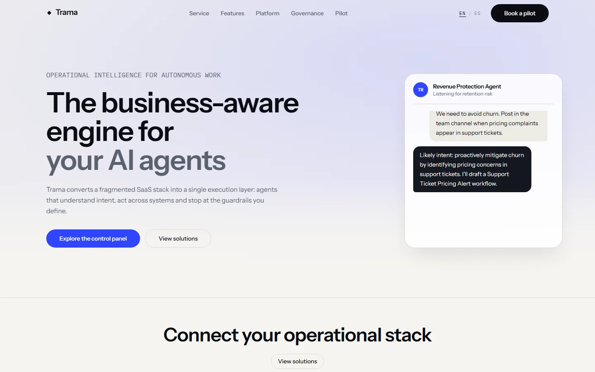

# Trama — Business-Aware Execution for AI Agents

A bilingual product site for an operational layer that gives AI agents the context of your business: the systems, the policies and the guardrails behind every action.



## Overview

Trama is a marketing site for an agent orchestration platform. It walks through the problem (fragmented SaaS stacks), the product surface (command center, draft plans, executions, governance logs) and the controls that keep autonomy honest — without inventing certifications or borrowing another vendor's brand.

The page is built on the structure of the original template, migrated to a typed bilingual content layer, a token-based design system and self-hosted assets.

## Key Features

- **Bilingual routing (`en` / `es`):** Typed dictionaries, `/[locale]` App Router segments, `Accept-Language` negotiation and a `trama.locale` cookie that remembers an explicit choice.
- **Product mocks without images:** The command center, the dashboard, the plan checklist and the governance table are pure HTML and CSS. No screenshots to go stale, no stock photography.
- **Honest trust section:** Five verifiable engineering controls (approval gates, audit log, scoped credentials, data residency, no training on customer data) instead of certification badges.
- **Accessible navigation:** Skip link, keyboard-operable mobile sheet, `aria-current` on the active locale and visible focus rings on every control.
- **Motion with intent:** Framer Motion reveals each section once it enters the viewport; the hero console types out a real workflow, and the integration marquee can be dragged or moved with the arrow keys.
- **Design tokens, not hex codes:** A single `@theme` block drives colour, type scale and section rhythm.

## Tech Stack

- **Framework:** Next.js 16.4.3 (App Router, Turbopack)
- **Library:** React 19.2.4
- **Language:** TypeScript 5.7.3 (strict)
- **Styling:** Tailwind CSS 4.3.3 with CSS-first tokens
- **Motion:** Framer Motion
- **Primitives:** Radix UI (dialog sheet, slots) and a single button component
- **Icons:** Lucide React
- **Analytics:** `@vercel/analytics`
- **Package Manager:** pnpm 11.17

## Architecture

```
trama/
├── docs/
│   ├── provenance.md          # Compliance ledger and transformation history
│   └── screenshot.webp        # Visual preview artifact
├── src/
│   ├── app/
│   │   ├── [locale]/
│   │   │   ├── [...rest]/page.tsx   # Catch-all that renders the 404
│   │   │   ├── layout.tsx           # Locale shell, font variables, analytics
│   │   │   ├── not-found.tsx
│   │   │   ├── opengraph-image.tsx  # 1200x630 social card
│   │   │   └── page.tsx             # Composed landing route
│   │   ├── globals.css              # Tokens, base layers and utilities
│   │   ├── icon.svg
│   │   ├── robots.ts
│   │   └── sitemap.ts
│   ├── components/
│   │   ├── landing/                 # Navbar, hero, features, demos, platform
│   │   │   └── agent-os/            # Product mocks and capability grids
│   │   ├── system/                  # Section, Container, headings, text
│   │   └── ui/                      # Button and sheet primitives
│   ├── config/site.ts
│   ├── i18n/
│   │   ├── config.ts
│   │   ├── dictionaries/            # Typed English and Spanish copy
│   │   └── get-dictionary.ts
│   ├── lib/
│   │   ├── seo.ts
│   │   ├── theme.ts                 # Section theme tokens
│   │   └── utils.ts
│   └── proxy.ts                     # Locale detection and persistence
├── eslint.config.mjs
├── next.config.ts
├── package.json
└── tsconfig.json
```

## Getting Started

### Prerequisites

- Node.js >= 20.9.0
- pnpm >= 10.0.0

### Installation

```bash
git clone https://github.com/JORDANROBERTO74/trama.git
cd trama
pnpm install
```

### Development

```bash
pnpm dev
```

Visit [http://localhost:3000](http://localhost:3000). The root redirects to `/en` or `/es` based on the request.

### Quality Checks

```bash
pnpm typecheck   # TypeScript, no emit
pnpm lint        # ESLint flat config
pnpm build       # Production build
```

## Deployment

The site is deployed on Vercel with the default Next.js preset. Import the repository, or run:

```bash
vercel deploy --prod
```

Set `NEXT_PUBLIC_SITE_URL` when serving from a custom domain; otherwise the canonical URL falls back to the domain in `src/config/site.ts`.

## Performance & SEO

- `/en` and `/es` are statically generated; the locale redirect runs in edge middleware.
- No remote media: the page ships without photographs or third-party fonts, so there is nothing to preload or negotiate.
- `sitemap.xml` and `robots.txt` derive from the locale configuration.
- OpenGraph and Twitter cards are generated at request time from the same dictionaries as the page.
- Fonts are preloaded by `next/font` with automatic size-adjust metrics, so headings do not shift on load.

## Accessibility

- Skip link to `#main`, semantic landmarks and a single `h1` per locale.
- The mobile menu is a focus-managed sheet with a labelled close control; `Escape` closes it.
- The marquee exposes a single region label, pauses on hover and focus, and supports arrow-key scrolling.
- Ink-on-bone and white-on-signal pairs clear WCAG AA; motion respects `prefers-reduced-motion`.

## Compliance & Licensing

This project was rebuilt under clean-room principles:

- No third-party trademarks, logos, stock photography, faces or certification marks appear anywhere in the repository.
- Integration names are generic categories (CRM, Ticketing, Billing, Data warehouse, Team chat, Identity), not vendor brands.
- All copy was rewritten for this project, and the Spanish dictionary is an original adaptation.
- The full audit trail, including everything that was removed, lives in [`docs/provenance.md`](docs/provenance.md).

## License

Proprietary, all rights reserved. See [LICENSE](LICENSE) for details.
